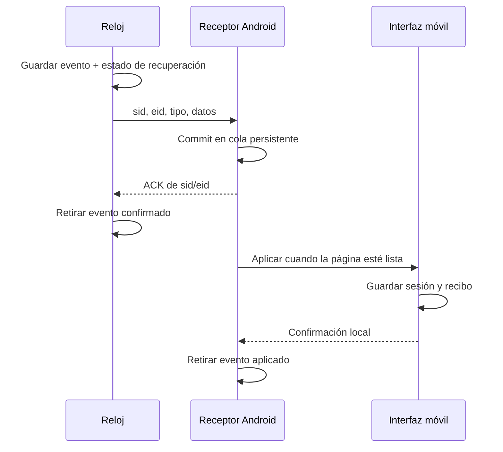

# ArcheryWatch 2.0 — entrenamiento y sincronización

16/09/2026. Android versionCode 37, protocolo 2. Compilaciones fr165 y fr165m.

## Implementado

- Esfera negra y naranja: avance de tanda, flechas/objetivo, número de tanda, estado, total, tiempo, pulso y eventos pendientes. Diseño propio.
- Tandas de 3, 6 y libres. Cierre por objetivo o manual; descanso sin contar movimientos de recogida. START inicia la siguiente tanda. Pausa/reanudar, flecha manual y deshacer desde menú. Vibración corta para tiro, larga para tanda; desactivable.
- Cerrar/reabrir y corregir límites: dividir desde una flecha o unir al set anterior. Borrado de flechas, sets y sesiones. En actividad v2 las correcciones del móvil se confirman desde el reloj; el histórico se modifica localmente.
- Perfiles de arco/muñeca, persistidos entre actividades. Calibración experimental: al menos cinco intervalos con tiro y cinco negativos; rechaza señales que se solapan. No aplica un umbral presentado como validado universalmente.
- Recuperación requiere 150 ms continuos bajo umbral; una sola muestra tranquila ya no basta. Ventana de gravedad de 500 ms ajustada al muestreo. Timestamps del sensor cuando están disponibles, alineados a una base relativa; alternativa nominal para firmwares antiguos. Ventanas previas y posteriores conservan sus tiempos.
- Comparador entre flechas de la tanda con escala común. Ritmo, mediana de estabilidad y recuperación; reproducción con duración nominal de la traza. Las fases del gráfico siguen siendo estimaciones y la traza representa aceleración relativa, no impactos ni mira calibrada.
- Progreso separado por perfil y versión de métrica, volumen semanal y total. Las flechas manuales no inventan estabilidad ni datos de sensor.
- Exportar/restaurar JSON desde navegador o selector nativo de Android. Importación conserva sesiones existentes y evita duplicarlas; no sobrescribe una sesión existente con una copia antigua.
- Diagnóstico en Sesión → Equipo y entrenamiento → Conexión: versión, estado del receptor, último mensaje recibido y eventos/órdenes pendientes.

## Inicio y fin de sesión: correcciones prioritarias

El usuario informó de falta de transferencia con una versión anterior instalada. No se pudo inspeccionar ese APK ni sus logs porque ADB y MTP no detectaban los dispositivos durante esta revisión. Por tanto, no se atribuye su fallo físico a una causa confirmada.

Sí se corrigieron problemas del flujo actual:

1. `start` abre la sesión móvil antes de recibir una flecha y muestra Sesión, salvo que el usuario consulte el historial.
2. Una actividad v2 vacía se restaura al abrir el móvil; no depende de tener tiros ni caduca artificialmente a los diez minutos.
3. `end` archiva los tiros y vuelve a Sesión vacía. Repetir inicio, tiro o final no duplica ni borra datos.
4. Enviar el final desde `onStop` y salir inmediatamente no garantiza entrega. **Guardar y salir** ahora guarda FIT, encola el final y espera la confirmación duradera del móvil antes de salir. Sin conexión se ofrece **Salir sin conexión**, conservando la cola para el siguiente arranque. Un cierre forzado del sistema no garantiza sincronización inmediata.
5. El receptor normaliza el UUID Connect IQ, vuelve a registrar eventos al reconectar y mantiene un único ciclo periódico de reintento.

Actualizar **los dos componentes juntos**: el reloj v2 necesita la confirmación del APK nuevo. No usar firmware v2 con un APK antiguo como prueba de esta versión.

## Protocolo y recuperación



El ACK confirma almacenamiento nativo, no que la interfaz esté abierta. Esto permite recibir con pantalla apagada. Si Android bloquea o el usuario fuerza la detención del servicio, el reloj conserva pendientes; no se puede prometer entrega instantánea en esas condiciones.

Las órdenes del móvil tienen cola persistente, identificador y ámbito por instalación. El reloj evita ejecutar de nuevo una orden confirmada. Guarda cada evento junto con un estado de recuperación; al reiniciar recupera también escrituras pendientes anteriores a la actualización del índice. Los buffers son finitos: un error de almacenamiento se muestra, y el FIT continúa siendo una fuente de recuperación. No se ha medido aún la capacidad máxima offline en el hardware físico.

## Pruebas realizadas

| Área | Resultado |
|---|---|
| Regresión frontend anterior | 30 comprobaciones correctas |
| Nuevos flujos y sincronización en navegador | 21 comprobaciones correctas, incluidos inicio vacío, restauración y final duplicado |
| Modelo de sesiones en Node | Correcto: identidad, reenvíos, borrados, límites y métricas manuales |
| Cola Java real | Correcto: persistencia, orden, confirmaciones duplicadas y fallos de escritura |
| Replay causal Python | 5 pruebas correctas: dos frecuencias, impulso, recuperación sostenida, ausencia de tiros, etiquetas y tiempos inválidos |
| Android | Compila y firma con la clave existente; avisos de API obsoleta y tipos genéricos, sin errores |
| Garmin | Compilan fr165, fr165m y el ejecutable de pruebas |
| Navegador móvil | Revisado a 390×844; sin desbordamiento horizontal ni errores de consola |
| Simulador Garmin | El proceso arrancó, pero no completó la conexión de monkeydo; **tests Monkey C no ejecutados** |
| Reloj → móvil físico | **Pendiente**: sin dispositivos detectados; no se instaló ni se borraron sesiones reales |

El CSV histórico se puede reproducir, pero carece de etiquetas independientes: encontrar un evento no prueba precisión real. El script viejo `detect_shots.py` queda identificado como prototipo v1; para v2 se usa:

```powershell
.venv/Scripts/python.exe tools/replay_detector.py captures/aw-session1.csv --rate 100 --out captures/replay-v2.json
.venv/Scripts/python.exe tools/replay_detector.py ruta/sesion.csv --labels ruta/etiquetas.json --out ruta/informe.json
```

Etiquetas independientes: `[{"t_ms": 1234, "label": "shot"}]`, con tiempo en la misma base del CSV. El informe cuenta aciertos, falsos positivos, tiros perdidos, duplicados y error temporal. Las marcas de calibración son **intervalos**, no verdad de terreno del instante exacto de la suelta. La equivalencia entre Python y Monkey C aún debe contrastarse ejecutando ambos sobre las mismas señales: no se presenta la prueba Python como ejecución del firmware.

## Prueba física pendiente, sin borrar historial

1. Actualizar APK conservando datos y firmware firmado para el modelo correcto. Abrir Garmin Connect y ArcheryWatch; conceder Bluetooth y notificaciones.
2. Abrir actividad en reloj: móvil debe mostrar sesión en vivo vacía. Confirmar `start` en Conexión.
3. Añadir una flecha manual: contador en ambos lados; sin métricas inventadas. Después comprobar un tiro real.
4. Cerrar tanda, pasar a la siguiente y corregir una flecha de prueba. Ambos contadores deben coincidir.
5. Apagar pantalla del móvil, registrar otro evento y volver: no debe faltar ni duplicarse.
6. Guardar y salir en reloj: móvil archiva la sesión, queda vacío y Conexión registra `end`.
7. Repetir sin Bluetooth: deben quedar pendientes; al reconectar con la app del reloj abierta, vaciar la cola conservando orden y sin duplicados.

La campaña de tiro real, la autonomía, la cola offline máxima y la entrega tras restricciones del fabricante Android quedan pendientes. Esta entrega no es una certificación de producción ni una cifra de precisión del detector.
